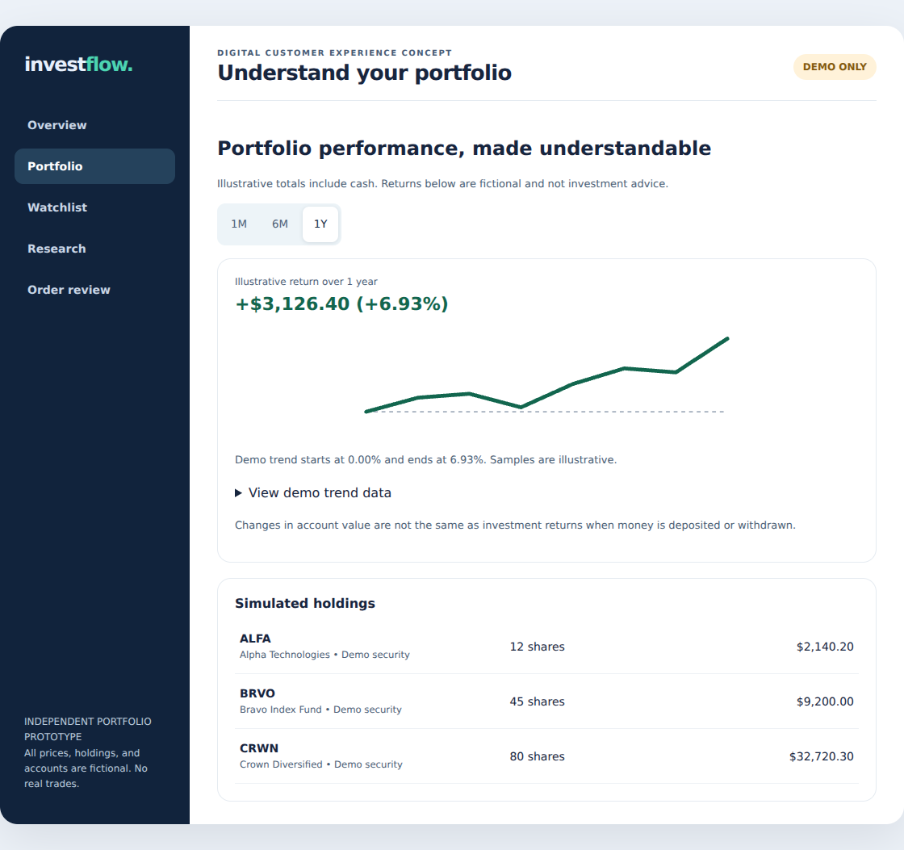

# InvestFlow Digital Customer Experience Redesign

**Deepika Kola | Digital business analysis, Agile delivery, and UX validation**

InvestFlow is an independently developed simulated portfolio project using demo investment data. It involved no financial institution sponsorship, customer research, real trades, or production release.

Retail investing users need to know what they can use, what changed in their portfolio, and what they are confirming. I translated those decisions into requirements, linked them to the Wrike delivery plan, and used browser tests to check the prototype. I used AI assistance for drafting, configuration, implementation, and test execution.

| Start here | What to look for |
| --- | --- |
| [Portfolio case study](docs/01_Portfolio_Case_Study.pdf) | Nine pages covering customer decisions, design rationale, delivery evidence, and readiness |
| [Interactive prototype](prototype/index.html) | Overview, Portfolio, Research, Watchlist, and simulated Order review |
| [UAT and accessibility report](docs/07_UAT_and_Accessibility_Report.pdf) | Five original failures reproduced and fixed. 23 of 23 checks passed in each of two browsers |
| [Business analysis](docs/02_Business_Analysis_and_Traceability.pdf) and [traceability workbook](data/InvestFlow_UAT_and_Traceability.xlsx) | Pain point to requirement, story, screen, test, and verified result |
| [Agile delivery plan](docs/03_Agile_and_Sprint_Documentation.pdf) and [release assessment](docs/06_Release_Readiness_and_Governance.pdf) | Planned delivery, verified prototype work, and open decisions |

## A five-minute walkthrough

1. In **Overview**, find the as-of date, cash and invested assets.
2. In **Portfolio**, change the period and compare the chart with the table under **View demo trend data**.
3. In **Research**, search for DLTA and save it. With the keyboard, confirm that focus stays on the save control. Use **Watchlist** to remove it.
4. In **Order review**, confirm two ALFA shares, then change the quantity to three. The estimate becomes $375 and the old confirmation clears.

Open the downloaded `prototype/index.html` in a browser. It is self-contained and does not require a server or credentials. The watchlist resets on reload.

## Delivery and testing evidence

- **Delivery scope:** 47 original tasks, 143 estimated story points, six sprint groups, seven native milestones, and 12 finish-to-start dependencies in the archived Wrike export. See the [Gantt](evidence/wrike/gantt.png), [Scrum Board](evidence/wrike/scrum-board.png), [sprint groups](evidence/wrike/sprint-groups.png), [dashboard](evidence/wrike/delivery-dashboard.png), and [schedule reconciliation](data/InvestFlow_Schedule_Reconciliation.xlsx).
- **Traceability:** [Story criteria](docs/04_User_Stories_and_Acceptance_Criteria.pdf), [project records](data/InvestFlow_Project_Records.xlsx), and [governance register](data/InvestFlow_Governance_Register.xlsx).
- **Before and after:** [Baseline test record](evidence/baseline/browser-results.json), [stale confirmation](evidence/baseline/order-stale-confirmation.png), [confirmation cleared after edit](evidence/prototype/order-confirmation-cleared.png), [Chromium results](evidence/prototype/browser-results.json), and [Firefox results](evidence/prototype/firefox-results.json).
- **Accessibility:** Axe found no violations in the selected automated rules across the five tested views in either engine. A separate contrast check sampled the Overview gradient. Screen readers, physical devices, Safari, and customer sessions remain untested.
- **Delivery boundary:** The screenshots are archived captures from the actual workspace. Wrike sign-in blocked live re-verification and updates. Sprint ceremonies and release gates are planned. Production acceptance remains open.

Tools and methods: Wrike, Scrum-style planning, Excel, requirements traceability, HTML, CSS, JavaScript, Playwright, Chromium, Firefox, and axe-core.

## GitHub Pages deployment

After approving the repository for publication, add the contents of this ZIP to the repository root. In **Settings > Pages**, choose **Deploy from a branch**, then select the intended branch and **/(root)**. The root [landing page](index.html) links to the prototype and case study. The landing page, both PDFs, and the demo order flow passed a local nested-path smoke test. Open the Pages URL after deployment and verify the links. No public URL has been deployed or verified for this package.

[GitHub Pages publishing source instructions](https://docs.github.com/en/pages/getting-started-with-github-pages/configuring-a-publishing-source-for-your-github-pages-site)
